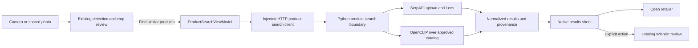

# Photo-to-product search with SerpAPI

**Status:** Original proposal for DATA-P14 / #207, November 10, 2026. Uses the supplied task and repository code; GitHub issue retrieval failed. See the implementation update below for the delivered subset; live evaluation remains future work.

**Implementation update:** The [small Debug simulator slice](../backend/product_search/README.md)
now implements reviewed SerpAPI searches, explicit Wishlist handoff and a comparison
runner using the existing catalog text/category baseline. The design below records
the broader proposal: OpenCLIP ranking, hosted authentication and live quality
evaluation remain future work. The implemented local endpoint accepts a raw JPEG
with `X-Request-ID`; it does not yet use the proposed multipart app-facing contract.

## Key architecture points

- Keep detection and retrieval separate: existing detection proposes garments; the user reviews one crop, then explicitly requests **Find similar products**. `ChoosePhotoButton.swift` remains a picker callback.
- Add one injected product-search service with interchangeable SerpAPI and catalog adapters. Camera supplies the query; Discovery owns reusable results UI; shared Codable responses belong in `Common/Models`.
- A Python backend receives the crop and holds the SerpAPI key. Search results neither publish the photo nor create closet records. The six-field `ClothingItem` stays unchanged.
- Existing code supplies crop editing, local catalog ingestion, and product-row layout. Live listing search, image-to-catalog retrieval, and an authenticated hosted search endpoint are proposed work.

## Recommendation

Start with **SerpAPI Google Lens visual matches**, as requested. Compare it against **OpenCLIP image retrieval over a small approved retailer feed** before choosing the production route. Prefer catalog retrieval later if controlled sources, reliable metadata, or measured operating costs outweigh its narrower coverage.

## Decision context

Assume US listings, explicitly identified USD prices, 200–500 real catalog products, and development photos; Neal must confirm these assumptions. Deliver a native simulator demo with a loopback backend. Production integration remains lead work.

Current provider documentation changes two implementation details: Lens `type=products` is [discontinued](https://serpapi.com/google-lens-products-api); use [`type=visual_matches`](https://serpapi.com/google-lens-visual-matches-api), treating price/stock as optional. The backend can [upload image bytes](https://serpapi.com/google-lens-upload-an-image), avoiding a public closet URL. The [Image API](https://serpapi.com/image-api) accepts at most 500 KB and expires its image ID after ten minutes; that does not establish deletion or retention guarantees.

## Options and total cost

Engineering estimates exclude access/procurement delays. Shared native UI and evaluation add **5–8 person-days**. Currency: USD; horizon: twelve months. Low/base/high usage is **100/1,000/5,000 garment searches monthly**, one search per crop, without enrichment or extra pages.

**H** = monthly hosting/storage/egress per option and workload; **F₀/F** = one-time/monthly feed fees; **U(Q)** = upload charges pending SerpAPI confirmation. These remain unknown. Local hosting uses the existing Mac. Labor is separate, without an hourly rate.

| Approach | Additional engineering | Launch cash | Monthly cash; maintenance estimate | Twelve-month cash, low/base/high | Main tradeoff |
| --- | --- | --- | --- | --- | --- |
| SerpAPI, paid listing search | 2–3 days: upload, adapter, filtering | $0 on eligible free tier, otherwise first plan payment | $0/$25/$75 + H + U(Q); 2–4 h/month | $0/$300/$900 + 12(H + U(Q)) | Broad discovery; provider changes, irrelevant pages and stale offers |
| Existing SQLite category/name search, in-house baseline | 1–2 days: real-feed mapping and query adapter | F₀; no new software fee | H + F; 2–4 h/month | F₀ + 12(H + F), all workloads pending measurement | Explainable and easy; relies on reviewed words and cannot rank visual resemblance |
| OpenCLIP + SQLite feed, open source | 3–6 days: embeddings, cosine ranking, refresh | F₀; $0 code license | H + F; 4–8 h/month | F₀ + 12(H + F), all workloads pending measurement | Local query processing and portable vectors; coverage and feed upkeep belong to Dressed |

[SerpAPI pricing](https://serpapi.com/pricing) lists 250 free searches/month, $25/1,000, and $75/5,000, with throughput limits. Successful empty searches consume a credit. [OpenCLIP](https://github.com/mlfoundations/open_clip) is maintained under an [MIT code license](https://github.com/mlfoundations/open_clip/blob/main/LICENSE); pin dependencies and review checkpoint terms. Google Product Search remains an alternative; its fixture adapter supplies neither catalog access nor a live index.

## Technical implementation

1. **Freeze the experiment.** Use 20 photos, approximately 30 crops, and ten held-out photos. Give both routes identical bytes and reviewed categories. Include worn outfits, occlusion, near-identical models and absent catalog products.
2. **Build backend retrieval first.** Add `backend/product_search/` alongside detection and catalog code. Upload a metadata-stripped, upright crop under 500 KB, then query `engine=google_lens&type=visual_matches&image_id=…`. Normalize results, preserve provenance, filter non-product pages, and return bounded results. Use one request budget and no automatic enrichment.
3. **Run the catalog comparison.** Import a current, approved retailer export through existing `backend/catalog/catalog.py`; compute versioned image embeddings and rank by cosine similarity. Join results back to active, fresh catalog records. The same feed supports the in-house text baseline. A synthetic feed cannot satisfy this experiment.
4. **Wire the native flow.** Both import-review screens open one results sheet. Reuse `CatalogProductRowLayout`, display “Similar,” and route Wishlist actions through existing product-link review. File responsibilities follow below.
5. **Verify and hand off.** Record live runs, latency, costs and misses; test parser failures, cancellation and stale responses. Exercise the signed-in native flow on a simulator per [iOS testing guidance](IOS_DEVELOPMENT.md). A later hosted endpoint must verify Firebase tokens, enforce owner scope and quotas, and pass unauthorized-access checks before lead integration.

## Decision gates

1. **Access and privacy — Neal:** name a permitted real feed and image-use policy; confirm provider processing/retention terms and the development spend ceiling. Feed availability is the largest unresolved dependency.
2. **Quality — proposed pilot thresholds:** useful top-five result for at least 70% of held-out crops; at least 90% of displayed purchase links reach the intended product; zero unsupported exact labels; end-to-end p95 under 15 seconds. Report counts and failures, not a claim of statistical certainty.
3. **Integration — lead:** compare measured coverage, freshness and cost; select sources, hosting and release scope. Keep the feature disabled if gates fail; manual closet entry remains available.

**Next decision for Neal:** approve the SerpAPI-first experiment and identify the real retailer feed for its catalog comparison. This proposal does not authorize purchases, deployment, or student assignments.

## Implementation appendix: folders and interfaces

All additions below are proposed, not files already implemented.

| Location | Responsibility |
| --- | --- |
| Existing `dressed/Camera/Views/ChoosePhotoButton.swift` | Keep selection UI only; no network request or key. |
| Existing `Camera/Views/PrototypeImportView.swift` (`ImportReviewView`) and `SharedImportReviewView.swift` | Add the per-candidate search action after crop review; pass candidate ID, image bytes and category. Search is independent of the save-selection checkbox. |
| Existing `Camera/ViewModels/SharedImportDraftStore.swift` | Reuse `imageData(for:in:)`; require crop review when a missing region would otherwise send the whole outfit. Search the real crop, not the stylized avatar preview. |
| New `dressed/Common/Models/ProductSearchSchema.swift` | One shared transient query/result contract. Keep canonical `CatalogProduct` and private closet records distinct. |
| New `dressed/Discovery/ViewModels/ProductSearchService.swift` | `ProductSearching.search(query:) async throws -> ProductSearchResponse`; injected HTTP and preview implementations, configurable development URL. |
| New `dressed/Discovery/ViewModels/ProductSearchViewModel.swift` | Own query task, result state and retry; cancel on dismissal, crop change or sign-out; reject late results from an old query. |
| New `dressed/Discovery/Views/ProductSearchResultsView.swift` and `ProductSearchResultRow.swift` | One sheet, reusable row layout, real image or explicit missing-image placeholder, name, retailer, optional price and source action. Debug comparison control displays each route's independently labeled results. |
| New `backend/product_search/service.py`, `serpapi_lens.py`, `catalog_matcher.py`, `evaluate.py` | Local HTTP boundary; provider normalization; catalog image ranking; paired evaluation. Keep existing recognition endpoints separate. |
| Existing `backend/catalog/` | Feed validation, stable IDs, partial/full refresh semantics and canonical catalog lookup. Add an approved-source mapper only after the source is chosen. |

**Proposed request:** `POST /product-search`, multipart crop plus `requestId`, `candidateId`, `category`, and development-only comparison route. Derive owner identity from a verified token on the hosted service, never from the body. Production selects the provider server-side. The first local process binds only to `127.0.0.1`; it is not an authenticated deployment or reachable from a physical phone.

**Proposed response:** `requestId`, `candidateId`, `provider`, `searchedAt`, `status`, and `matches[]`. Each match has a stable result ID, optional canonical `catalogProductId`, title, image URL, source name/domain, retailer name when established, source link, optional decimal price plus ISO currency, availability, rank, `matchKind`, identity evidence, and separate `offerCheckedAt`/link status. These are transient listing hits; a Lens hit does not become a trusted catalog entry merely by mapping its fields. Unknown metadata stays absent. A `$` symbol alone does not establish USD, and search time does not establish retailer price freshness.

Use backend-only environment configuration locally and managed secrets when hosted. Strip EXIF and enforce byte/pixel limits; discard temporary crop bytes after processing. Never log keys, provider request URLs containing keys, or private image bytes. Confirm provider retention separately. Cache retries by authenticated owner, candidate ID, crop hash, provider and configuration version for a short proposed ten-minute window; coalesce in-flight duplicates. Crop edits create a new query. Cancellation can stop local work but cannot guarantee reversal of an already billed provider request.

Return explicit empty, timed-out, rate-limited, unavailable and invalid-input outcomes. Retain the crop so retry/manual editing works. Reject malformed response fields individually without turning a failed request into a successful empty set. Keep error and result states separate for each comparison route. Turn the new action off to roll back; no existing saved-record migration is required.

Use HTTPS product links with retailer-domain attribution. For the pilot, review a bounded retailer allowlist, record rejected domains, and report coverage before and after filtering. A 200 response alone is not proof of a product page. Any backend link checker must restrict redirects and block private/local destinations; unknown or blocked pages remain unverified. Offer fields remain “observed” until checked against the source. Do not crawl arbitrary search results as a catalog ingestion shortcut.

## Evaluation appendix: what completes the task

**Real catalog:** obtain a current CSV/JSON export from a participating retailer, with stable product/variant IDs, purchasable URLs and permission to process images. Source identity is TBD. Map it into the existing feed shape, record capture time and hash, and refresh it for the second evaluation run. Freeze the catalog before examining held-out queries; include relevant items and distractors without selecting only easy positives. The saved eBay response adapter is an alternative mapping starting point only if live access and reuse terms are approved.

Run both routes freshly against every frozen crop; save actual responses and run metadata outside Git for audit/replay. Do not count fixture playback as live evidence. Record model/checkpoint hash, catalog version, compression settings, locale, provider request ID, cache state, timings and charged searches. Report crop preparation/detection time separately from retrieval, plus total time to visible results. Repeat live queries after 24–48 hours and recheck displayed offers to expose listing drift. Count compressed crops as identical inputs, but also record failures attributable to inaccurate detection in a separate end-to-end pass.

For each crop, show the input and top five results with available image/name/retailer/price/link. Have a reviewer judge each as same verified product, useful alternative, wrong item, or unjudgeable. Report useful-hit@5, precision@5, zero-result and error rates, catalog coverage, and catalog recall@5 conditional on the identified product being present. Keep absent-catalog cases in the overall coverage denominator. Record wrong-model sneakers, accessory-versus-garment confusion, dead links, missing metadata, price/stock disagreement and blocked pages. Compare p50/p95 latency, cost per query, cost per useful result, refresh lag, and maintenance effort. Small-sample p95 is descriptive only.

**Exact-match rule:** default every visual result to **Similar**. “Exact product” requires evidence connecting the photographed item to a verified source product identifier, such as a readable tag/GTIN corroborated by the retailer or a provenance-verified source photo tied to its listing. Check brand, model and color/variant; state when size is unknown. A result having its own SKU does not identify the query garment. Neither cosine similarity, a user's visual guess, nor Lens's [`exact_matches` output](https://serpapi.com/google-lens-exact-matches-api) establishes product identity. Preserve evidence and its scope; otherwise retain “Similar.” The first demo can keep exact labeling disabled.

Implementation verification should cover missing price/currency, wrong response IDs, duplicate retries, late responses after crop edits, timeouts/429s, unsafe links, expired uploads, stale catalog records and zero results. Native acceptance should use the documented test account through normal sign-in, capture screenshots, open a source link and confirm that only an explicit Wishlist review saves it. Report isolated fixture XCUITests separately. Before hosting, test missing/expired tokens, cross-owner request/cache access, quotas and image cleanup with development data.
